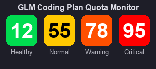

# GLM Quota Monitor

智谱 GLM Coding Plan 用量监控小工具。实时显示周配额使用百分比，支持系统托盘图标和悬浮小组件两种模式。



## 功能

- **系统托盘图标**：右下角显示彩色圆角方块 + 百分比数字，颜色随用量变化（绿/黄/橙/红）
- **悬浮小组件**：始终置顶的无边框小窗口，可拖拽到任意位置，比托盘图标更大更醒目
- **Web Dashboard**：本地网页展示 5h 滚动配额、周配额、MCP 月度调用三档详细数据
- **自动刷新**：每 30 秒自动查询 API 更新数据

## 快速开始

### 1. 获取 API Key

登录 [智谱开放平台](https://bigmodel.cn/usercenter/proj-mgmt/apikeys)，创建或复制你的 API Key。

### 2. 运行

```bash
# 托盘图标模式（默认）
python server.py

# 悬浮小组件模式（推荐，不会被系统折叠）
python server.py --widget

# 仅网页模式
python server.py --web-only
```

Windows 用户也可以直接双击 `start.bat`（托盘模式）或 `start.bat widget`（小组件模式）。

首次运行会提示输入 API Key，保存后下次自动加载。

### 3. 依赖

```bash
pip install pystray Pillow
```

`start.bat` 会自动检测并安装缺失的依赖。

## 颜色说明

| 颜色 | 用量范围 | 含义 |
|------|---------|------|
| 🟢 绿色 | < 45% | 用量充裕 |
| 🟡 黄色 | 45% - 70% | 正常使用 |
| 🟠 橙色 | 70% - 90% | 注意用量 |
| 🔴 红色 | > 90% | 即将耗尽 |

## 项目结构

```
glm-quota/
├── server.py      # 主程序（HTTP 服务 + 托盘/小组件）
├── index.html     # Web Dashboard
├── start.bat      # Windows 启动脚本
├── config.json    # API Key 配置（首次运行自动生成，已加入 .gitignore）
└── .gitignore
```

## 注意事项

- `config.json` 包含你的 API Key，已加入 `.gitignore`，请勿手动提交到版本控制
- 本工具仅查询配额信息，不会调用任何模型，不产生额外费用
- GLM Coding Plan 个人版的配额 API 为 `GET https://open.bigmodel.cn/api/monitor/usage/quota/limit`

## License

MIT
